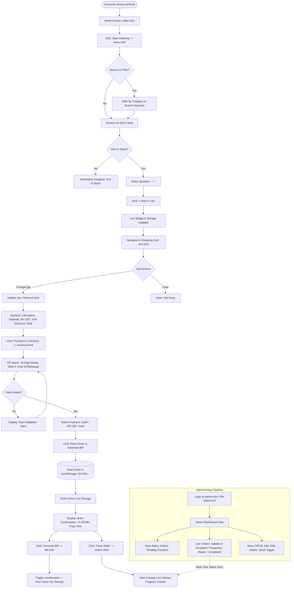
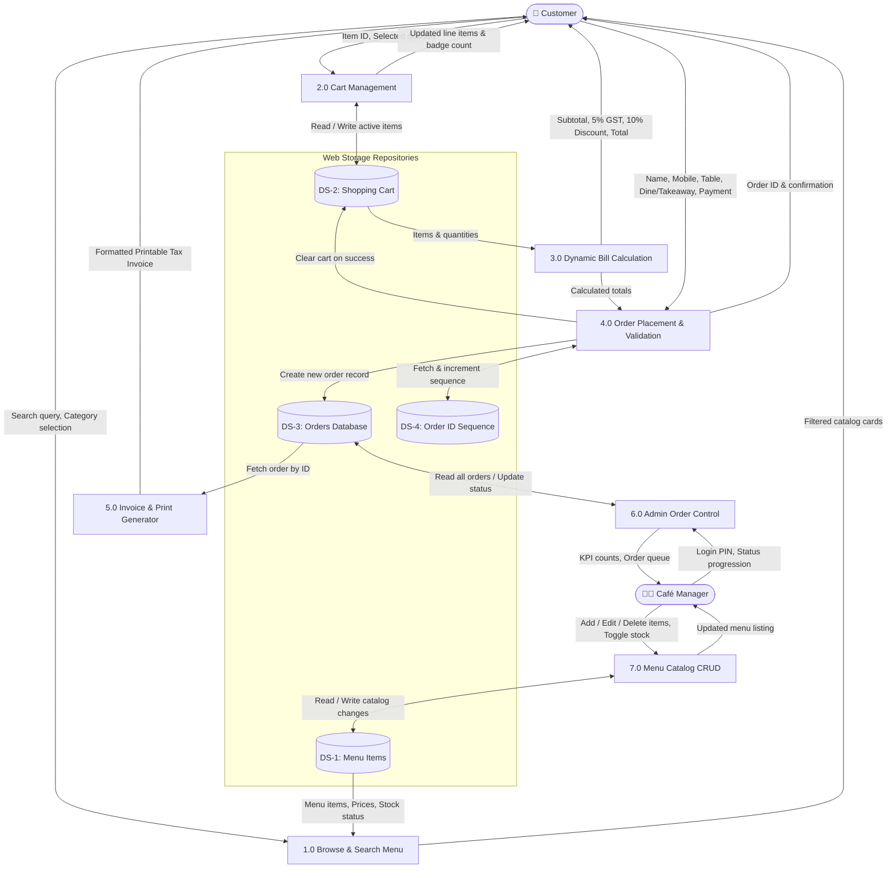
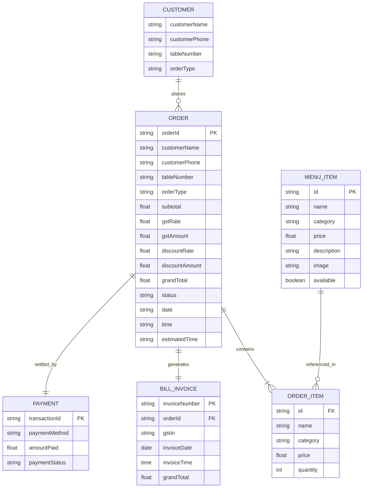

# SMART CAFÉ – DIGI-MENU & AUTO BILLING MACHINE
## College Mini Project – Comprehensive Technical Report & Viva Dossier

**Course / Branch:** B.Tech Computer Science & Engineering  
**Project Title:** Smart Café – Digi-Menu & Auto Billing Machine  
**Technology Stack:** HTML5, CSS3, Vanilla JavaScript (ES6+), Web Storage API (LocalStorage)  
**System Architecture:** Client-Side Single-Terminal Kiosk / Event-Driven Web Application  

---

## Table of Contents
1. [Project Abstract](#1-project-abstract)
2. [Project Objectives](#2-project-objectives)
3. [Traditional System vs. Smart Café System](#3-traditional-system-vs-smart-café-system)
4. [System Architecture & Workflow](#4-system-architecture--workflow)
5. [Project Flowchart](#5-project-flowchart)
6. [Data Flow Diagrams (DFD)](#6-data-flow-diagrams-dfd)
   - [Level 0 Context Diagram](#level-0-context-diagram)
   - [Level 1 Detailed DFD](#level-1-detailed-dfd)
7. [Entity-Relationship (ER) Diagram](#7-entity-relationship-er-diagram)
8. [Database & LocalStorage Schema](#8-database--localstorage-schema)
9. [Detailed Function-by-Function JavaScript Explanation](#9-detailed-function-by-function-javascript-explanation)
10. [Mathematical Formulation & Billing Rules](#10-mathematical-formulation--billing-rules)
11. [System Advantages](#11-system-advantages)
12. [System Limitations](#12-system-limitations)
13. [Future Scope](#13-future-scope)
14. [15 Viva Questions with Model Answers](#14-15-viva-questions-with-model-answers)
15. [Conclusion](#15-conclusion)

---

## 1. Project Abstract

In today's fast-paced hospitality and food-service industry, customer experience and service velocity are critical drivers of business success. Traditional café operations frequently struggle with labor-intensive ordering procedures, paper menu deterioration, order taking misunderstandings, arithmetic inaccuracies during manual bill generation, and extended customer queuing during rush hours.

**Smart Café – Digi-Menu & Auto Billing Machine** is an autonomous, web-based self-service kiosk application designed to streamline customer ordering and café management. Developed using HTML5, modern CSS3 (with responsive CSS Grid, Flexbox, and print media queries), and Vanilla JavaScript, the application operates client-side utilizing the browser's Web Storage API (`localStorage`). 

The system enables patrons to explore an interactive digital menu categorized into 5 distinct food domains (Beverages, Fast Food, Pizza, Main Course, Desserts) encompassing 24 curated dishes. Patrons can conduct real-time full-text searches, review live inventory availability, adjust portions, and add selections to a shopping cart. The billing module automatically calculates subtotal, computes statutory Goods & Services Tax (5% GST), applies an intelligent incentive discount (10% discount on orders of ₹500 and above), and outputs a professional, print-ready tax invoice. Simultaneously, orders are dispatched with a sequential tracking ID (`SC1001`, `SC1002`, etc.) to an integrated **Admin Dashboard**, which provides café management with live sales KPIs, kitchen order status advancement (`Pending` → `Accepted` → `Preparing` → `Ready` → `Completed`), and menu inventory control (CRUD).

---

## 2. Project Objectives

1. **Self-Service Automation:** Implement a responsive digital ordering kiosk simulation eliminating the necessity of physical waiter interactions for menu browsing and order dispatch.
2. **Dynamic Mathematical Invoicing:** Provide an automated billing calculation engine that deterministically computes Item totals, Subtotals, statutory 5% GST, and threshold-based discounts without human error.
3. **Inventory & Stock Awareness:** Visually communicate real-time item availability with visual badges and button state disabling for out-of-stock items.
4. **Digital Record Persistence:** Utilize browser `localStorage` to ensure zero data loss during page reloads for shopping carts, completed order history, sequential order IDs, and administrator menu alterations.
5. **Real-Time Kitchen Pipeline Management:** Enable café administrators to inspect live incoming orders and progress kitchen status, which synchronizes with customer tracking in real time.
6. **Zero External Dependencies:** Engineer a lightweight, zero-dependency software product that functions out-of-the-box in any modern browser without mandatory backend server configurations.

---

## 3. Traditional System vs. Smart Café System

| Comparative Dimension | Traditional Café Operations | Smart Café Digi-Menu System |
| :--- | :--- | :--- |
| **Menu Presentation** | Static paper menus; prone to physical wear, tearing, and outdated pricing. | Interactive, categorized digital menu with instant search and dynamic pricing. |
| **Order Placement** | Verbal order conveyed to waiter; manual handwritten KOT (Kitchen Order Ticket). | Direct customer touch interaction via kiosk interface; precise selections. |
| **Stock Transparency** | Customers are only notified of unavailable items after attempting to order. | Real-time "Out of Stock" badges; automatic disabling of cart additions. |
| **Billing & Math** | Manual calculation by cashier using calculator or basic cash register; error-prone. | 100% automated algorithmic calculation of Subtotal, 5% GST, and 10% Discount. |
| **Invoice Generation** | Manual handwritten slips or slow thermal POS printing queues. | Instant digital tax invoice with one-click print layout (`window.print()`). |
| **Order Status** | Customer must repeatedly call or look for servers to ask for status updates. | Live 5-stage graphical progress tracker (`Received` → `Accepted` → `In Kitchen` → `Ready` → `Served`). |
| **Data Analytics** | End-of-day manual register tallying; time-consuming and error-prone. | Real-time Admin KPIs: Total Orders, Gross Sales (₹), Total Items Sold, and Pending queue. |

---

## 4. System Architecture & Workflow

The system is architected as an **Event-Driven, Single-Device Web Application** with bidirectional synchronization mediated through the HTML5 Web Storage API (`localStorage`) and Custom DOM Events (`smartcafe_cart_updated`, `smartcafe_menu_updated`, `smartcafe_orders_updated`).

```
+---------------------------------------------------------------------------------+
|                                CLIENT BROWSER                                   |
|                                                                                 |
|   +------------------------------------+  +---------------------------------+   |
|   |          CUSTOMER INTERFACE        |  |         ADMINISTRATOR UI        |   |
|   |  • index.html (Kiosk Home)         |  |  • admin.html (Manager Console) |   |
|   |  • menu.html (Search & Filter)     |  |    - PIN Auth (admin123)        |   |
|   |  • cart.html (Dynamic Total)       |  |    - Live KPIs (Sales, Orders)  |   |
|   |  • checkout.html (Validation/Pay)  |  |    - Order Status Pipeline      |   |
|   |  • bill.html (Printable Invoice)   |  |    - Menu Inventory CRUD        |   |
|   |  • orders.html (Live Stepper)      |  +---------------------------------+   |
|   +------------------------------------+                    ^                   |
|                     |                                       |                   |
|                     v                                       v                   |
|   +-------------------------------------------------------------------------+   |
|   |                          CONTROLLER & LOGIC LAYER                       |   |
|   |     js/data.js  •  js/menu.js  •  js/cart.js  •  js/checkout.js         |   |
|   |     js/bill.js  •  js/orders.js • js/admin.js •  js/common.js           |   |
|   +-------------------------------------------------------------------------+   |
|                                         |                                       |
|                                         v                                       |
|   +-------------------------------------------------------------------------+   |
|   |                     BROWSER STORAGE ENGINE (STORAGE API)                |   |
|   |  • smartcafe_menu_items     (JSON Array of 24 Catalog Objects)          |   |
|   |  • smartcafe_cart           (JSON Array of Active Line Items)           |   |
|   |  • smartcafe_orders         (JSON Array of Placed Order Records)        |   |
|   |  • smartcafe_last_order_id  (Sequential Integer Counter: 1001, 1002...) |   |
|   |  • smartcafe_admin_logged_in (Boolean Auth Flag)                        |   |
|   +-------------------------------------------------------------------------+   |
+---------------------------------------------------------------------------------+
```

---

## 5. Project Flowchart



---

## 6. Data Flow Diagrams (DFD)

### Level 0 Context Diagram

```mermaid
flowchart TD
    Customer([👤 Customer])
    Admin([👨‍💼 Café Admin / Manager])
    System[[☕ Smart Café Digi-Menu & Auto Billing System]]

    Customer -->|1. Food Inquiries & Item Selection| System
    Customer -->|2. Customer Contact & Table Details| System
    Customer -->|3. Simulated Payment Information| System
    
    System -->|4. Dynamic Price, GST & Discount Breakdown| Customer
    System -->|5. Order Confirmation & Unique Order ID| Customer
    System -->|6. Printable Digital Tax Invoice| Customer
    System -->|7. Live Kitchen Status Updates| Customer

    Admin -->|8. Manager Passcode (admin123)| System
    Admin -->|9. Order Workflow Status Changes| System
    Admin -->|10. Menu Catalog Additions / Edits / Deletions| System

    System -->|11. Real-time Sales Metrics & Daily Statistics| Admin
    System -->|12. Live Kitchen Order Pipeline| Admin
```

---

### Level 1 Detailed DFD



---

## 7. Entity-Relationship (ER) Diagram



---

## 8. Database & LocalStorage Schema

The system uses standard key-value storage in `localStorage`. Below is the technical specification of each storage structure:

### 1. Key: `smartcafe_menu_items`
- **Type:** JSON Array of Objects
- **Example Record:**
```json
[
  {
    "id": "bev_1",
    "name": "Cappuccino",
    "category": "Beverages",
    "price": 120,
    "description": "Freshly ground rich espresso topped with foamy steamed milk and a dusting of cocoa.",
    "image": "https://images.unsplash.com/photo-1572442388796-11668a67e53d?w=600",
    "available": true
  }
]
```

### 2. Key: `smartcafe_cart`
- **Type:** JSON Array of Cart Objects
- **Example Record:**
```json
[
  {
    "id": "ff_1",
    "name": "Veg Burger",
    "category": "Fast Food",
    "price": 120,
    "quantity": 2,
    "image": "https://images.unsplash.com/photo-1568901346375-23c9450c58cd?w=600"
  },
  {
    "id": "bev_2",
    "name": "Cold Coffee",
    "category": "Beverages",
    "price": 100,
    "quantity": 1,
    "image": "https://images.unsplash.com/photo-1517701550927-30cf4ba1dba5?w=600"
  }
]
```

### 3. Key: `smartcafe_orders`
- **Type:** JSON Array of Completed Order Objects (ordered newest first)
- **Example Record:**
```json
[
  {
    "orderId": "SC1025",
    "customerName": "Aditya Singh",
    "customerPhone": "9876543210",
    "tableNumber": "Table 12",
    "orderType": "Dine In",
    "items": [ ... ],
    "subtotal": 340.00,
    "gstRate": 5,
    "gstAmount": 17.00,
    "discountRate": 0,
    "discountAmount": 0.00,
    "grandTotal": 357.00,
    "paymentMethod": "UPI",
    "transactionId": "SCUPI784512",
    "status": "Pending",
    "date": "13/09/2026",
    "time": "07:30 PM",
    "createdAt": "2026-09-13T14:00:00.000Z",
    "estimatedTime": "15–20 minutes"
  }
]
```

### 4. Key: `smartcafe_last_order_id`
- **Type:** String (Integer Representation, e.g. `"1025"`)
- **Usage:** Incremented sequentially to generate human-readable unique order tags (`SC1001`, `SC1002`, etc.).

### 5. Key: `smartcafe_admin_logged_in`
- **Type:** String (`"true"` or removed)
- **Usage:** Stores session authentication state for the admin console.

---

## 9. Detailed Function-by-Function JavaScript Explanation

### `js/data.js` (Data & Storage Engine)
1. **`initMenuStorage()`**: Checks if `smartcafe_menu_items` exists in `localStorage`. If empty or null, seeds the storage with the default 24 items across 5 categories.
2. **`getMenu()`**: Safely retrieves and JSON-parses the menu items array from storage.
3. **`saveMenu(menuArray)`**: Serializes and writes modified menu items back to `localStorage` and dispatches the global `smartcafe_menu_updated` event.
4. **`resetDefaultMenu()`**: Overwrites current menu storage with the factory 24 default dishes.
5. **`getCart()` / `saveCart(cartArray)` / `clearCart()`**: Standard transactional accessors for active user cart items.
6. **`getCartItemCount()`**: Aggregates all quantities across the cart using `Array.prototype.reduce()`.
7. **`getOrders()` / `saveOrders(ordersArray)`**: Accessors for all recorded customer orders.
8. **`generateNextOrderId()`**: Reads the integer counter in `smartcafe_last_order_id`, increments it, writes it back, and formats the alphanumeric Order ID (e.g. `SC1001`).
9. **`calculateBill(cartItems)`**: Central billing engine implementing statutory formulas (see Section 10).

### `js/common.js` (UI Coordination)
1. **`initNavbar()`**: Configures responsive hamburger toggle and click-outside listeners for mobile viewports.
2. **`highlightActiveNavLink()`**: Dynamically inspects `window.location.pathname` to apply the `.active` CSS class to the corresponding navigation link.
3. **`updateCartBadges()`**: Queries all cart badges across the DOM and updates numerical content with a CSS pop animation (`@keyframes popScale`).
4. **`showToast(message, type, duration)`**: Generates temporary, non-blocking toast notifications with status colors (success, warning, danger).

### `js/menu.js` (Catalog & Filtering)
1. **`initMenuPage()`**: Initializes category buttons, attaches real-time search event listeners, and mounts initial cards.
2. **`setupSearchListener()`**: Attaches an `'input'` listener to the search input, transforming query to lowercase for substring matching.
3. **`renderCategoryPills()`**: Calculates dish counts per category and renders interactive filter pills.
4. **`selectCategory(cat)`**: Updates the active category filter variable and triggers re-rendering.
5. **`renderMenu()`**: Filters the menu array based on `currentCategory` and `searchQuery`, generating responsive HTML cards with image fallbacks and stock tags.
6. **`stepQty(itemId, delta)`**: Stepper handler that increments or decrements the local card quantity input within safe bounds (1 to 20).
7. **`addToCart(itemId)`**: Adds the selected item and quantity to the cart array or increments existing item quantity, triggering cart badge updates.

### `js/cart.js` (Shopping Cart)
1. **`renderCart()`**: Renders cart items in an accessible table format alongside a dynamic order summary panel and incentive discount progress bar.
2. **`updateItemQuantity(itemId, delta)`**: Adjusts item quantity directly in the cart; removes the item if quantity drops to zero.
3. **`handleRemoveItem(itemId, itemName)`**: Deletes a single item row from the cart array.
4. **`handleClearCart()`**: Prompts user confirmation to empty the entire cart array.

### `js/checkout.js` (Customer Intake & Payment)
1. **`initCheckout()`**: Verifies that the cart is not empty before allowing checkout access.
2. **`renderCheckoutSummary(cart)`**: Displays an itemized mini-table and dynamic total breakdowns.
3. **`setupPaymentMethodToggle()`**: Dynamically switches input sub-panels (Cash note, simulated UPI QR code, mock Card inputs) based on radio button selection.
4. **`handlePlaceOrder(e)`**: Performs validation checks on Customer Name (≥2 chars), 10-digit Phone regex (`^[0-9]{10}$`), and Table number. Upon validation, generates unique Order ID, builds complete Order object, commits to `localStorage`, flushes cart, and displays the confirmation screen.

### `js/bill.js` (Invoice & Printing)
1. **`renderBill()`**: Parses `?orderId=...` query parameter from the URL, retrieves the matching record, and renders the official Tax Invoice.
2. **`handlePrintInvoice()`**: Invokes JavaScript's native `window.print()` API, which triggers `@media print` CSS rules to isolate and print only the invoice.

### `js/orders.js` (Tracking & Stepper)
1. **`renderOrdersPage()`**: Renders a list of all historical customer orders and mounts a 5-step live progress bar for the latest order.
2. **`renderStepperTrack(status)`**: Maps order status to visual nodes (`Pending` → `Accepted` → `Preparing` → `Ready` → `Completed`).
3. **`showOrderDetailsModal(orderId)`**: Opens an itemized popup modal displaying complete order information without leaving the page.

### `js/admin.js` (Administration & Inventory)
1. **`initAdmin()`**: Checks manager authentication flag; renders PIN login form if locked or dashboard if unlocked.
2. **`setupLoginForm()`**: Compares entered PIN with `admin123` and writes authentication flag to storage.
3. **`renderDashboardStats()`**: Computes live KPIs (Total Orders, Gross Sales, Total Items Sold, Pending Orders) using JavaScript array methods (`reduce`, `filter`).
4. **`updateOrderStatus(orderId, newStatus)`**: Advances an order's status in `localStorage`, reflecting immediately in customer order tracking.
5. **`renderAdminMenu(container)`**: Displays an inventory data table with stock status indicators and action buttons.
6. **`toggleItemStock(itemId)`**: Toggles item availability between `true` and `false`.
7. **`handleSaveMenuItem(e, existingId)`**: Processes Add/Edit modal forms, validating input and persisting new or modified dishes to menu storage.
8. **`handleDeleteMenuItem(itemId, itemName)`**: Removes a dish from the menu catalog after confirmation.

---

## 10. Mathematical Formulation & Billing Rules

The billing engine executes deterministic calculations using floating-point precision rounded to 2 decimal places:

### 1. Subtotal
$$\text{Subtotal} = \sum_{i=1}^{n} (\text{Price}_i \times \text{Quantity}_i)$$

### 2. Goods and Services Tax (GST)
Statutory rate of **5.0%** (comprising 2.5% CGST + 2.5% SGST):
$$\text{GST Amount} = \frac{\text{Subtotal} \times 5}{100}$$

### 3. Incentive Discount (Conditional Threshold)
$$\text{Discount} = \begin{cases} 
\frac{\text{Subtotal} \times 10}{100} & \text{if } \text{Subtotal} \ge ₹500 \\
0 & \text{if } \text{Subtotal} < ₹500 
\end{cases}$$

### 4. Grand Total
$$\text{Grand Total} = \text{Subtotal} + \text{GST Amount} - \text{Discount}$$

---

## 11. System Advantages

1. **Reduced Customer Wait Time:** Eliminates wait times for physical menus and manual cashier calculations.
2. **Zero Arithmetic Errors:** Automated billing logic ensures exact GST calculation and correct discount application every time.
3. **Paperless Digital Invoices:** Generates clean digital receipts with one-click print/PDF options.
4. **Full Catalog Control:** Café managers can update dish details, prices, and stock availability on the fly.
5. **No Server Setup Required:** Pure client-side implementation runs in any browser with zero installation overhead.
6. **Responsive Kiosk Design:** Fluid layouts adapt seamlessly to mobile devices, tablets, and desktop kiosk displays.

---

## 12. System Limitations

1. **Client-Bound Storage Scope:** Data stored in `localStorage` is isolated to the specific browser domain and will not synchronize across disparate physical devices without a centralized backend database.
2. **Simulated Payment Gateway:** The UPI QR code and credit card forms simulate transactions for educational demonstration; no live banking APIs (Razorpay, Stripe) are integrated.
3. **Client-Side Authentication:** Admin PIN authorization is handled client-side for simplicity; production environments would require server-side token validation (JWT / OAuth2).

---

## 13. Future Scope

1. **Centralized Cloud Backend:** Migrate from `localStorage` to Node.js/Express with MongoDB or Firebase Firestore for multi-device synchronization.
2. **Live Payment Gateway Integration:** Integrate real-world payment SDKs (e.g. Razorpay, Paytm, Stripe) for automated UPI and card webhook settlement.
3. **QR Code Table Ordering:** Generate table-specific dynamic QR codes allowing customers to scan with personal smartphones and automatically bind their table number.
4. **Kitchen Display System (KDS):** Deploy a dedicated tablet view for kitchen cooks with audio chime notifications when new tickets arrive.
5. **WhatsApp & SMS Receipt Delivery:** Integrate Twilio or WhatsApp Business API to deliver invoices directly to customer mobile numbers.
6. **AI Recommendations Engine:** Utilize recommendation algorithms to suggest food pairings (e.g., suggesting French Fries when a Burger is added).

---

## 14. 15 Viva Questions with Model Answers

### Q1: What is the primary objective of the Smart Café project?
**Answer:**  
The primary objective is to build an autonomous, web-based self-service ordering kiosk and automated billing system. It eliminates long counter lines, automates mathematical calculations (subtotal, 5% GST, conditional discounts), provides instant digital tax invoices, and gives managers live kitchen tracking and menu inventory control.

### Q2: Why did you choose HTML5, CSS3, and Vanilla JavaScript instead of heavy frameworks like React or Angular?
**Answer:**  
For a college mini-project demonstration, Vanilla JavaScript provides high performance, zero build-step overhead, and lightweight execution without dependencies. Evaluators can inspect the core algorithms directly (DOM manipulation, event handling, data structures), proving a solid foundation in core computer science web standards.

### Q3: How does the system persist data without a traditional SQL/NoSQL database?
**Answer:**  
The project utilizes the HTML5 **Web Storage API (`localStorage`)**, which stores key-value pairs persistently in the user's browser across page refreshes and browser sessions. We serialize JavaScript arrays and objects to JSON strings using `JSON.stringify()` on write and parse them back with `JSON.parse()` on read.

### Q4: Explain the billing logic and the dynamic discount algorithm.
**Answer:**  
The subtotal is calculated as $\sum (\text{Price} \times \text{Quantity})$. We compute 5% GST ($\text{Subtotal} \times 0.05$). If the Subtotal is ₹500 or higher, a 10% discount is applied ($\text{Subtotal} \times 0.10$); otherwise the discount is ₹0. The Grand Total is $\text{Subtotal} + \text{GST} - \text{Discount}$. All figures are dynamically updated whenever quantities change.

### Q5: How is the unique sequential Order ID generated?
**Answer:**  
In `js/data.js`, the function `generateNextOrderId()` inspects the key `smartcafe_last_order_id` in `localStorage`. If no ID exists, it seeds at `1000`. Each new order increments this integer (e.g., `1001`, `1002`) and prefixes it with `"SC"`, yielding human-readable IDs like `SC1001`, `SC1002`, ensuring every order receives a distinct identifier.

### Q6: How does the real-time search feature work in `menu.js`?
**Answer:**  
An `'input'` event listener is attached to `#menu-search-input`. As the customer types, the input string is converted to lowercase. The `renderMenu()` function filters the menu array using `Array.prototype.filter()`, checking if the dish name, description, or category contains the query substring via `String.prototype.includes()`.

### Q7: What happens when an item is marked "Out of Stock" by the admin?
**Answer:**  
In `admin.js`, toggling an item flips its boolean `available` property to `false`. When `menu.js` renders that card, it adds an `.out-of-stock` CSS class, renders an "Out of Stock" badge, and disables the "+ Add to Cart" button with the HTML `disabled` attribute, preventing customers from ordering unavailable inventory.

### Q8: How does the print functionality work on `bill.html`?
**Answer:**  
The "Print Bill" button invokes the browser API `window.print()`. In `style.css`, a dedicated `@media print` stylesheet hides the navigation bar, footer, interactive buttons, and toast containers, formatting only the `#printable-bill-area` cleanly on a white background with crisp borders for A4 or thermal receipt output.

### Q9: How is customer input validated on `checkout.html`?
**Answer:**  
The form validates that the Customer Name contains at least 2 alphabetic characters, the Mobile Number matches a 10-digit regex (`^[0-9]{10}$`), and a Table Number is selected when Dine In is chosen. If any validation fails, form submission is blocked and a toast notification highlights the required field.

### Q10: How does the admin dashboard update the customer's order status in real-time?
**Answer:**  
When an admin clicks a status progression button (`Accept`, `Preparing`, `Ready`, `Completed`), `admin.js` updates the order's `status` field in `smartcafe_orders` and dispatches a custom DOM event (`smartcafe_orders_updated`). On `orders.html`, an event listener captures this event and re-renders the 5-stage visual progress stepper immediately.

### Q11: How do you prevent broken image links if an image URL fails to load?
**Answer:**  
Every `` element includes an inline `onerror` fallback handler: `onerror="this.onerror=null; this.src='data:image/svg+xml;utf8,...'"` which swaps in a lightweight inline SVG placeholder if a network image fails to load.

### Q12: What is the purpose of `js/common.js`?
**Answer:**  
`common.js` handles cross-page shared functionality: highlighting the active navigation menu item based on current URL path, managing the mobile hamburger menu toggle, computing and animating cart badge counts, and hosting the global toast notification generator (`showToast`).

### Q13: What are the differences between `localStorage` and `sessionStorage`?
**Answer:**  
`localStorage` persists data indefinitely until explicitly cleared by the user or script, surviving browser closures and reboots. `sessionStorage` expires as soon as the specific browser tab or window is closed. `localStorage` was chosen so orders and custom menu items persist across sessions.

### Q14: How would this project scale to a multi-branch commercial system?
**Answer:**  
By replacing `localStorage` with a REST or GraphQL API backed by Node.js/Express and PostgreSQL/MongoDB, introducing WebSockets for real-time kitchen push notifications, connecting an official payment gateway (Razorpay/Stripe), and hosting the application on cloud infrastructure (AWS/GCP).

### Q15: What is the role of CSS custom properties (variables) in your stylesheet?
**Answer:**  
In `style.css`, the `:root` pseudo-class defines reusable design tokens (e.g. `--primary-dark`, `--accent-gold`, `--bg-cream`, `--shadow-md`). This ensures visual consistency across all 8 pages, simplifies global theme adjustments, and keeps the CSS clean and maintainable.

---

## 15. Conclusion

**Smart Café – Digi-Menu & Auto Billing Machine** demonstrates how standard modern web technologies can be orchestrated to solve real-world operational inefficiencies in the food-service industry. By combining responsive UI design, modular Vanilla JavaScript logic, client-side data persistence, automated GST and discount calculations, and real-time kitchen pipeline management, the project delivers a practical, educational, and fully functional self-service kiosk application suitable for college project assessment.
